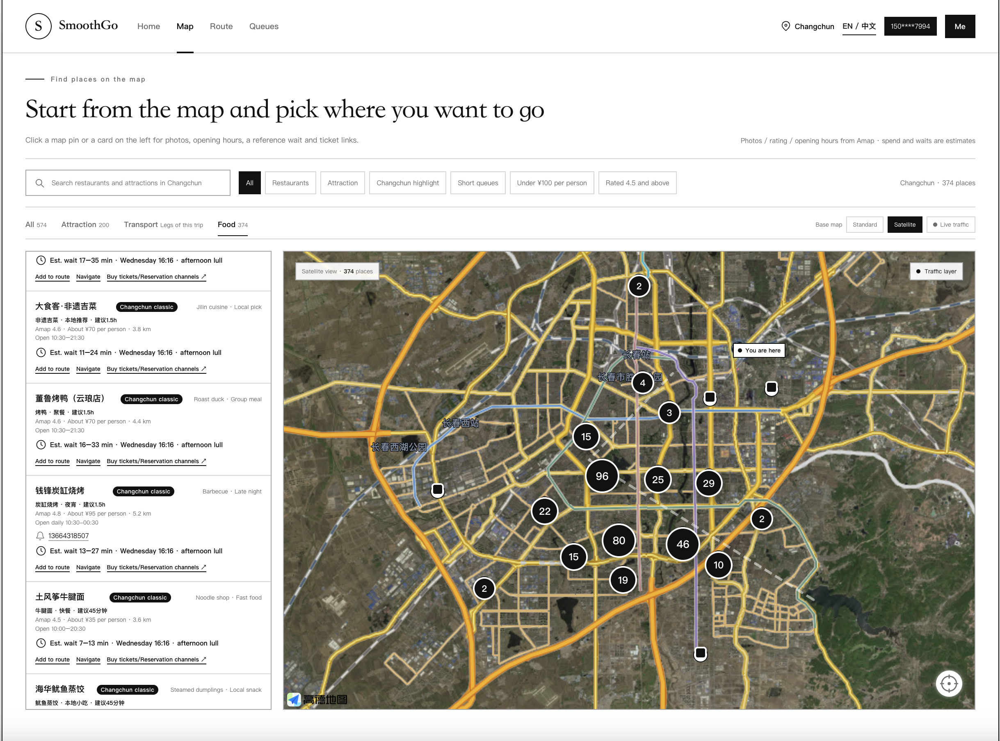
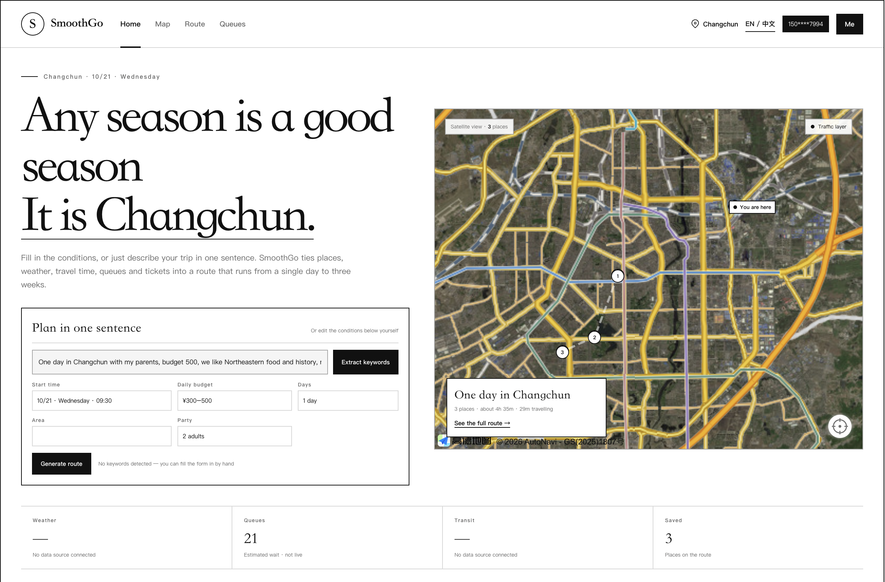
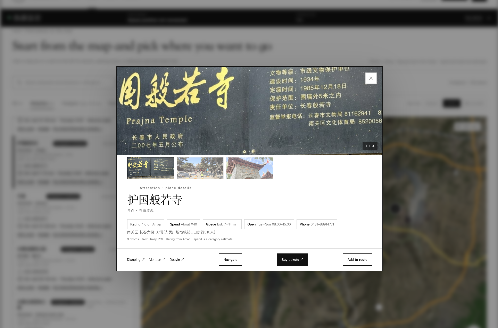
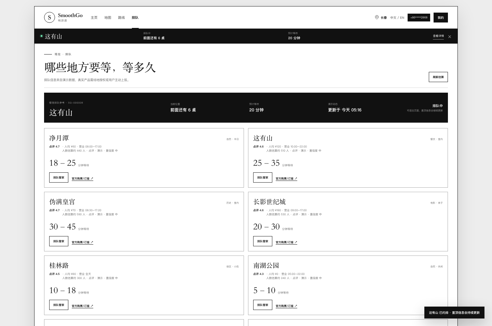

# SmoothGo (畅游通)

**Travel smart. Skip the wait.**

SmoothGo is an AI-assisted travel planner that turns live crowd and queue signals into a personalized, continuously updated day plan. The first pilot is designed for **Changchun, China**, with a roadmap to expand to other Chinese tourism cities.

> This repository is a student project for the ENGL1006 Business Communication final presentation at Changchun Normal University, delivered in partnership with Southern Cross University (SCU). The demo uses illustrative data and is not affiliated with any venue, map provider, or booking platform.

## The problem

Travelers do not only need a list of attractions. They need to know **what is worth doing now**, given:

- their interests and available time;
- current crowd levels and queue times;
- travel distance between stops;
- weather, opening hours, and energy levels.

Most travel products help users discover places. SmoothGo helps them **decide and re-decide** as conditions change.

## The product

The current web prototype demonstrates:

1. **Editable or natural-language planning** — time, daily budget, location, group, interests and a trip length from 1 to 21 days.
2. **Map discovery** — 574 places seeded from the Amap POI harvest, filters by category and specialty, real Amap scores and opening hours, queue estimates.
3. **Multi-day route planning** — Day tabs, one meal per day, budget-aware choices, and a map that only shows the currently selected day.
4. **Replan** — replace the busiest stop in the selected day with a same-category alternative, explain the trade-off and undo the change.
5. **Map navigation** — standard or satellite base map, an Amap live-traffic overlay, and one-tap navigation handoff to Amap. No crowd counters: any number of that kind would be invented.
6. **Booking handoff** — each place links out to whoever actually sells the ticket: the venue's own phone line (426 of 574 places have one), its Amap POI page, 美团, 点评 and 抖音. Links go through our own `/api/go` so a dead one can be fixed server-side; that endpoint never accepts a URL from the caller, so it cannot be turned into an open redirect. SmoothGo issues no order, takes no payment and shows no fare table. 美团 and 点评 are **copy-the-keyword** rows, not links: their web search pages sit behind a login or bot wall (verified — they redirect to `mlogin.dianping.com` and `verify.meituan.com`), so pointing a logged-out visitor at them would be pointing at a door. Official WeChat mini-program links are supported but unlisted: a third party cannot mint a URL Scheme for somebody else's mini program, so that field stays empty until a venue hands us its own link.
7. **Place sheet with a photo gallery and a menu** — every place shows all the photos Amap returned (504 of 574 have two or three) instead of a single thumbnail, with a thumbnail strip and counter. Restaurants also show a 招牌菜 list keyed by brand, so all 24 老昌春饼 branches share one menu. 141 of 360 restaurants are covered; the rest say 未收录 and offer a copy-the-name action rather than a plausible-looking list. No prices: Amap has no dish or price field and 点评/美团 block logged-out visitors, so a price would be invented.
8. **Transit-code handoff** — 交通 view and route panel open a 乘车码 sheet. 支付宝乘车码 has a public scheme and is opened directly; 微信 and 云闪付 have none, so those rows show the tap path; 长春E出行 / 长春市民卡 are named as the official apps (the 市民卡 app gives 9折 on 长春轨道交通). SmoothGo does not render a code and does not take the fare — an earlier version drew a fake QR out of the line name, which is exactly what this replaces.
9. **Queue assist demo** — submitting a request adds a bar at the top of the 排队 page (it stays there while you scroll) and a compact strip under the header on the other views. Both repeat the wait length you picked in the sheet; neither counts down, because no queue feed is connected. Guests can submit: the request is stored in the browser and marked 游客演示, and only a signed-in account saves it server-side against the monthly quota.
10. **Account and queue assist demos** — guest preview, phone login, saved multi-day routes and membership-quota preview.
11. **Bilingual interface** — the whole UI runs in Chinese or English; the switch sits in the header and the choice is remembered per browser.

**Place identity is real.** Names, coordinates, districts, opening hours, scores and photos come from the Amap POI API. Everything else is either derived — average spend from a category band, travel time from a distance estimate or an Amap route — or explicitly labelled 未接入 / 演示. There is no real payment, SMS, ticketing or queue-assistance order in this version.

## Live demo

Open `web/index.html` directly, or serve the folder:

```bash
cd web
python3 -m http.server 8080
```

Then visit `http://localhost:8080`.

The web demo is intentionally dependency-free so it can run from GitHub Pages or a USB stick without a build step.

### Bilingual interface (中文 / EN)

The interface is bilingual and defaults to Chinese. The switch in the header toggles between `中文` and `EN`, and the choice is kept in `localStorage` under `smoothgo_lang`, so it survives a reload.

How it is put together:

- `web/i18n.js` owns both dictionaries. `EN` covers strings the code renders; `EN_MARKUP` covers the sentences that sit in `index.html`. The Chinese text is the key, so a missing entry falls back to Chinese instead of showing an empty label.
- `t()` translates copy, `tv()` translates vocabulary that is also a data value (categories, badges, confidence levels), and `th()` rewrites the recurring words in Amap opening-hours strings, so `周二至周日 09:00-17:00` becomes `Tue–Sun 09:00-17:00`.
- The static markup is translated by walking text nodes and remembering the Chinese, so switching back restores it exactly.

What stays in Chinese, on purpose — the same way a maps app shows a local business in its own language: place names, the hand-written subtitles, and any Amap category the dictionary has not met yet. Nothing invents an English name for a shop.

### Preview









## Repository structure

```text
SmoothGo/
├── web/                  # Static interactive prototype
├── presentation/         # English slide deck, PDF backup and speaker notes
├── docs/                 # Team plan, presentation outline, Q&A bank, sources
├── tests/                # Planner tests (node) and server tests (python, stdlib)
├── LICENSE               # MIT, code only
├── NOTICE                # Third-party data attribution (Amap)
├── PRIVACY.md            # What the prototype does with an account
├── SECURITY.md           # Controls in place, controls missing
└── README.md
```

## Presentation package

- `presentation/SmoothGo_Presentation.pptx` — 14-slide English deck with speaker notes.
- `presentation/SmoothGo_Presentation.pdf` — backup copy.
- `docs/team-plan.md` — six-person roles, task ownership and one-week schedule.
- `docs/group-message.md` — copy-ready group chat message for assigning tasks.
- `docs/presentation-outline.md` — slide-by-slide English outline.
- `docs/qa-bank.md` — likely questions and short answers.

## Product logic (prototype)

The recommendation score combines:

- interest match;
- current crowd pressure;
- expected queue time;
- travel time;
- venue rating;
- fit with the user's available time.

The prototype uses a transparent rule-based scorer with illustrative data. It balances interest match, budget fit, queue pressure, rating and travel time, then uses a meal-aware ordering pass for each day. Multi-day plans avoid repeated venues until the Changchun seed pool is exhausted, after which later days visibly reuse places. Replan keeps the venue category, prefers a matching interest, penalises repeated scene types, and only accepts a candidate that reduces queue time. A production version would connect to venue APIs, map services, user reports, and a trained crowd-forecasting model.

## Current web prototype

- `web/index.html` — full-page prototype with four views: Home, Map, Route and Queue.
- Natural-language extraction recognizes budget, time, group and interest keywords.
- Multi-day planning supports 1–21 days with Day tabs and per-day Replan; long trips reuse the limited seed venue pool and mark those days as “复用”.
- A trip visits each chain once. 元盛居 has four real branches and 老昌春饼 has 24 in the library, so the planner keys on the name before the first parenthesis and drops the rest of a brand once one branch is scheduled — 元盛楼(盛元盛居)(万福总店) keeps its own brand, since it is a different name that merely contains 元盛居. Without this, a five-day plan ate at 元盛居 on four of the five days.
- Resorts Amap files under 度假疗养场所 are only planned if they carry opening hours or a phone number. 天定山旅游度假小镇 has both and stays; 鹿鸣谷净月潭休闲度假区 has neither, and an address of just 长清公路, so it never wins a slot. This is the only venue the rule removes from the shipped library, and a test guards its width.
- Route and home maps show only the selected day’s stops; the discovery map matches the left-hand search and category filters exactly (`全部`, `景点`, `美食`, `交通`).
- `web/planner.js` — dependency-free route scoring and Replan logic, shared by the browser and unit tests.
- Amap provides the standard map, satellite imagery and live-traffic tiles; the route line and marker coordinates are illustrative.
- Satellite imagery cannot count individual people, and the app no longer shows any people count. The queue bar repeats the wait length chosen in the sheet and says 队列位置未接入 rather than inventing a position.
- “开始导航” and the per-place navigation buttons hand off to Amap navigation; the prototype does not run a custom turn-by-turn engine.
- Dianping-style rating, average price and review-count fields are demo data; a production version requires an authorized API or partnership.
- The phone login and queue-assist flows are clearly labelled as demos.
- The account panel shows a demo membership quota; no payment or subscription is processed.
- Signed-in queue-assist requests are stored per account, so the monthly quota and the queue bar survive a page refresh. A guest request lives in `localStorage` only and is labelled 游客演示.
- The footer links to a privacy, terms and data-boundary explainer for the prototype.

## Develop and verify

The maintained source lives in `web/`. Run the planner tests and rebuild the offline single-file backup after changing the web app:

```bash
node --test tests/planner.test.js
python3 -m unittest tests.test_server -v
python3 docs/build_standalone.py
```

The generated `SmoothGo-Web-Demo.html` runs without a server or Amap key, using the schematic map and guest mode. The online version at `http://localhost:8080/` uses `web/config.js`.

## Accounts and search history

Phone + password registration is the default tab in the login dialog, with the
original SMS flow kept as a second tab:

- `POST /api/auth/register` — `{phone, password}` creates an account and returns a session token. Passwords must be at least 6 characters and are stored as PBKDF2-HMAC-SHA256 hashes with a random per-user salt; the plaintext never reaches the database.
- `POST /api/auth/login` — `{phone, password}` returns a session token.
- `POST /api/auth/verify` — the SMS code flow still works and is unchanged.
- `GET /api/searches` / `POST /api/searches` — read and append search history for the logged-in user. Rows are scoped by `user_id`, so one account cannot read another account's history. The page records a search automatically after “生成路线”.
- `GET /api/queue-requests` / `POST /api/queue-requests` — read and save simulated queue-assist requests for the logged-in user. The free demo quota defaults to **2 requests per calendar month** (`QUEUE_MONTHLY_LIMIT`); no request creates a real order or payment.

Accounts created through the SMS flow have no password. They deliberately cannot
be claimed through password registration, because that would let anyone take over
a number they do not control — use the code flow for those accounts.

These features need `server/app.py`. GitHub Pages only serves static files, so a
deployed site stays in guest mode unless you host the API separately and point
`apiBaseUrl` in `web/config.js` at it.

## Deploy to GitHub Pages

The repository includes `.github/workflows/pages.yml`. In GitHub, open **Settings → Pages** and select **GitHub Actions** as the source. A push to `main` will publish the `web/` folder.

`web/config.js` is gitignored so real keys never enter the repository. The workflow regenerates it at deploy time from repository secrets:

- Go to **Settings → Secrets and variables → Actions → New repository secret**
- `AMAP_KEY` — your Amap Web JS API key
- `AMAP_SECURITY_CODE` — the matching security code

If those secrets are missing, the workflow falls back to `web/config.example.js`, so the site still deploys but the map falls back to the schematic view.

## Amap and real phone registration

- **Amap:** apply for a Web JS API key, add your domain to the whitelist, then run `cp web/config.example.js web/config.js` and fill in the two values.
- **Real phone login:** run `server/app.py` and configure a real SMS provider in `server/.env`.
- **Local mock mode:** keep `SMS_PROVIDER=mock` and `DEV_SHOW_CODE=1` for testing; this does not send real SMS.
- **Production:** set `authMode: "real"` in `web/config.js`, use HTTPS, set a strong `OTP_SECRET`, set `DEV_SHOW_CODE=0`, and configure Aliyun SMS or a webhook.

### Recommended for personal accounts: `SMS_PROVIDER=aliyun_verify`

The classic Aliyun `SendSms` API (`SMS_PROVIDER=aliyun`) requires an enterprise
qualification, a filed signature and an approved template, which personal
accounts cannot obtain. `aliyun_verify` uses Aliyun **Phone Number Verification
Service** (`Dypnsapi` / `SendSmsVerifyCode`) instead: it sends through the
system-granted signature and template, so a personally verified account can send
real verification codes the same day.

1. Enable **短信认证** and **融合认证** at <https://dypns.console.aliyun.com/functions>.
2. Create an AccessKey (a RAM user with `dypns:SendSmsVerifyCode` is recommended).
3. Copy a granted signature and template from
   <https://dypns.console.aliyun.com/smsCertParamsConfig/sign> — a granted
   signature must be paired with a granted template.
4. Fill `ALIYUN_VERIFY_ACCESS_KEY_ID`, `ALIYUN_VERIFY_ACCESS_KEY_SECRET`,
   `ALIYUN_VERIFY_SIGN_NAME` and `ALIYUN_VERIFY_TEMPLATE_CODE` in `server/.env`,
   then set `SMS_PROVIDER=aliyun_verify` and `DEV_SHOW_CODE=0`.

Code generation and verification stay local; Aliyun is only the delivery
channel. Only mainland China numbers are supported, and billing is per delivered
message (¥0.06 each under 1,000/month — there is **no** free quota, and the
converged-authentication trial plan cannot be applied to standalone SMS
verification).

### Free alternative: push the code to WeChat

If you only need the code to reach a phone for a demo or defence, skip SMS
entirely. Use `SMS_PROVIDER=webhook` with `SMS_WEBHOOK_FORMAT=pushplus`:

```ini
SMS_PROVIDER=webhook
SMS_WEBHOOK_FORMAT=pushplus
SMS_WEBHOOK_TOKEN=<your-pushplus-token>
```

1. Sign in at <https://www.pushplus.plus> with WeChat; your token is on the home page.
2. Follow the **pushplus** official account, otherwise sends fail with code `600`.
3. Restart the server — the code then arrives as a WeChat message, not an SMS.

The free tier allows 200 messages a day, plenty for a demo. Keep
`SMS_WEBHOOK_FORMAT=raw` if you would rather post to your own gateway, which
receives `{"phone","code","template"}`.

See [`server/README.md`](server/README.md) for the complete setup.

## Real store data (Amap POI)

The **Map** view ends with a *搜索附近好店* panel: type a keyword such as
`东北菜`, pick a city, and SmoothGo returns real places with **name, category,
address and phone number**. Results are dropped onto the live map and each card
can recentre the map or open Amap navigation.

It calls `AMap.PlaceSearch` straight from the browser with the **Web JS API key
you already have**, so nothing new has to be applied for and the panel works on
GitHub Pages, where no backend exists.

```text
GET /api/poi/search?keywords=东北菜&city=长春        # keyword search
GET /api/poi/search?keywords=咖啡&location=125.32,43.81&radius=3000
```

The optional `server/` endpoint above proxies the same data server-side. It is
only useful if you deploy `server/` yourself and would rather keep a
**Web-service key** off the page. Add `AMAP_WEB_SERVICE_KEY=...` to
`server/.env`. Note the two key types are **not interchangeable**: the JS key
cannot call `restapi.amap.com`, and the Web-service key cannot render a map.

**What Amap does return:** requesting `extensions: "all"` gives a real `rating`,
`opentime2` and up to three `photos` per place. Those are stored as `rating`,
`hours` and `photo` / `photos`, and the UI labels the score as **高德 4.7** rather
than implying it came from anywhere else. Coverage across the generated library:
rating 99%, photo 97%, hours 87%.

**What Amap does not return:** average spend, ticket price and live queue length.
Dianping has no public POI API for any of that — its open platform serves
merchants managing their own stores, not third-party lookups. So `avg` is filled
by `estimate_spend()` in `scripts/build_places.py`, a **per-person band derived
from the Amap sub-category** (火锅 95, 东北菜 70, 咖啡 45, parks 0 ...), and the UI
renders it as **人均约 ¥70** to make clear it is neither a measured bill nor a
merchant figure. The old hand-written cards did carry a `ticket` field (¥30, ¥70,
¥180 — none of it checked); it is gone, and the 购票 button opens a list of
outbound channels instead, because printing a fare the app cannot honour is how a
demo starts lying about money. Channels always resolve: every place came from
Amap, so its Amap page and its listed phone always exist.

## Place library

The map draws on two layers:

| Source | Count | Fields |
|---|---|---|
| `web/app.js` (hand-written) | 23 | 9 attractions + 14 restaurants that Amap indexes poorly: streets, snack rows, night markets. No photos of their own — they borrow the Amap photo on merge |
| `web/places.poi.js` (generated) | 560 | real name, category, address, phone, coordinates, **rating, opening hours, photos** from Amap |

That is 583 rows before merging. The two layers overlap on 9 places (南湖 vs 南湖公园,
桂林路 vs 桂林路商业街), so the merged library ships **574 places: 200 attractions
and 374 restaurants** within 40 km of downtown Changchun. 14 of the 23 hand-written
rows adopt the Amap rating, hours and photo of the same place, which is why no
card shows an invented score next to a real one.

**Chains are kept branch by branch.** Searching a brand name (700CC, 老昌春饼,
王记酱骨) returns every branch inside the city limit, so a chain appears once per
location with its own address and phone instead of a single generic entry.

**Sub-spots are folded into their host.** Amap returns a scenic area plus every
point inside it (`净月潭国家森林公园-月潭览胜`, `长春市动植物公园-雉鸡馆`). Keeping
those would turn one destination into thirty rows, so `is_sub_spot()` in
`scripts/build_places.py` drops the children and `ALIASES` collapses official
aliases (净月潭 / 净月潭国家森林公园 / 净月潭国家级风景名胜区) onto one name.
Entrances, car parks, charging stations, ticket offices and law firms are
filtered by `BAD_NAME` / `BAD_TYPE`.

**The 长春特色 badge is editorial, not from Amap.** Two tiers are hand-maintained
in the build script: `FEATURED_ATTRACTION` (20 keywords → badge 长春地标) and
`FEATURED_FOOD` (18 keywords → badge 长春名吃). Because a chain matches on its
brand keyword, all its branches are badged too, so 56 of the 574 places carry a
specialty badge. Category words like 东北菜 or 火锅 are deliberately excluded —
matching them would badge half the library and the badge would mean nothing.
The list sorts specialties first, landmarks before food, and a landmark's own
name before its satellite venues.

**Everything the app claims but cannot source is labelled.** No live feed is
connected for weather, bus arrival, road congestion, queue length or ticketing,
so those panels say **未接入** instead of showing a number that looks
authoritative. Menus are editorial (`web/place-menus.js`): dish names only, no
prices, no combos — the five 团购 packages the old sheet advertised (双人餐 ¥168,
四人餐 ¥298 …) were invented and are gone. Ride codes are not ours either; the
sheet hands the phone to 支付宝/微信/云闪付 and says so, because a code we drew
ourselves would not open a gate. What *is* real: place identity, coordinates,
opening hours, photos and scores come from Amap; the road-colour layer is Amap's
own `TileLayer.Traffic`. Queue ranges are estimates (`confidence: "低"`) drawn
from two narrow constants, which is why they are excluded from the home-page
"waiting venues" signal and every card that shows one carries the suffix
**参考等候 · 非实时**.

**Travel time has two tiers, and the UI says which one it is showing.** The
planner needs a number hundreds of times per keystroke, and it runs
synchronously, so it uses haversine x 1.35 at 26 km/h clamped to 8–90 minutes.
Once a plan is on screen the display layer asks `AMap.Driving` / `Transfer` /
`Walking` for the real leg and repaints; the route panel carries a 高德 / 估算
tag and the transport layer lists the real legs it got. Where Amap returns
nothing (no transit option, request refused, offline) the estimate stays and is
labelled as one.

With 574 places on the map, pins overlap badly at city zoom, so the map view
switches to `AMap.MarkerCluster` above 60 visible places. Clusters render as
dark bubbles with a count; clicking one zooms in two levels, and past zoom 15 the
clusters break apart into individual pins. Route view and sparse filters stay on
plain markers so stop order numbers stay readable.

Rebuild it, or point it at another city by editing `CITY` in
`scripts/fetch_poi.py`:

```bash
python3 server/app.py &
agent-browser open "http://127.0.0.1:8080/#map"
python3 scripts/fetch_poi.py
python3 scripts/build_places.py
agent-browser close
```

## Safety and compliance

SmoothGo does **not** sell tickets or promise priority entry. Queue assistance is presented as a request-and-handoff service only for venues that explicitly allow it. The pilot prioritizes restaurants and non-strict queue environments; scenic-area queueing remains information-only until local rules are confirmed.

The same points are written out for the code itself in [`SECURITY.md`](SECURITY.md), and what the app does with an account is in [`PRIVACY.md`](PRIVACY.md).

## Data sources and attribution

The code in this repository is MIT licensed. **The place data is not.** See [`NOTICE`](NOTICE) for the full text; in short:

- 574 place records (200 attractions, 374 restaurants) were retrieved from the **Amap** POI API — names, coordinates, addresses, districts, opening hours, ratings and, for 560 of them, the listed phone number. Rights remain with 高德软件有限公司 (Autonavi). They are included for non-commercial teaching demonstration only and are subject to the Amap open-platform terms and quota.
- Photographs are referenced by URL from Amap hosts (`store.is.autonavi.com`, `aos-comment.amap.com`) — 1,074 references, no image file is stored in this repository. Every photo is fetched from Amap when the page renders.
- `web/place-menus.js` (招牌菜), the 长春地标 / 长春名吃 badges and all queue estimates are **authored by this project**, not sourced from any platform. Queue figures carry `confidence: "低"` and the 参考等候 · 非实时 suffix.
- 美团 / 点评 / 抖音 / 支付宝 / 微信 / 云闪付 / 长春E出行 are named for identification; their marks belong to their owners.

Regenerating the library against your own key is the intended path if you want to point it at another city:

```bash
python3 scripts/fetch_poi.py && python3 scripts/build_places.py
```

## Roadmap

- **Now:** Changchun pilot with 5–10 partner venues and a clickable prototype.
- **Next:** user-reported crowd data, merchant dashboard, and English/Chinese UI.
- **Later:** expand to Xi'an, Chongqing, and Changsha; integrate live venue APIs and a learned queue-forecasting model.

## Team

Six-member student team, Computer Science, Changchun Normal University.

## License

MIT License. See `LICENSE` — it covers the **source code** only. Place data, photographs and third-party marks are covered by the attribution terms in [`NOTICE`](NOTICE).
